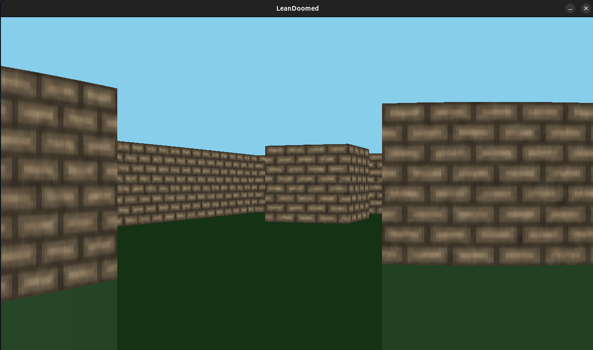

# Lean SDL3 Bindings Example

Playing around with SDL3 bindings in Lean4 to learn about the FFI.

Simple real-time Doom-style raycasting engine in Lean4:

Targets Lean 4.34.1, SDL 3.4.18 and SDL_image 3.4.8. Lake pins the SDL
release tags, builds them with CMake, and links the C binding. Requires Git,
CMake and a system C compiler; headless tests additionally require Python 3.



## Run

### Unix (Linux, Mac)

```bash
# Install elan if this is your first time using Lean
curl https://elan.lean-lang.org/elan-init.sh -sSf | sh

# Clone project
git clone --recursive https://github.com/oOo0oOo/LeanDoomed.git
cd LeanDoomed

# Run the "game". The initial run will take a few minutes to compile everything.
lake exe LeanDoomed
```

### Windows (MSYS2 or WSL)

On Windows, use MSYS2 or WSL!

**IMPORTANT**: FOR MSYS2, MAKE SURE YOU ARE USING THE "CLANG" SHELL TO RUN EVERYTHING!

For more information on MSYS2, see: https://github.com/leanprover/lean4/blob/master/doc/make/msys2.md

Next, follow the instructions for Unix above.

## Build and check

```bash
lake build
SDL_VIDEODRIVER=dummy SDL_RENDER_DRIVER=software lake test
SDL_VIDEODRIVER=dummy SDL_RENDER_DRIVER=software lake exe LeanDoomed --smoke
```

The smoke mode runs three frames and exits. The tests check generated C ABI
signatures and `DrawColumn` scalar offsets, collision/raycast behavior, invalid
scancodes, texture loading, cleanup, a bounded event loop, and exact pixel equality
between the old per-column reference renderer and the batched renderer, with and
without a texture. Validated on Linux with SDL's dummy video/software render
drivers; interactive display, macOS and Windows checks are still needed.

Existing `vendor/SDL` and `vendor/SDL_image` checkouts at older versions must be
preserved and moved aside before the first build. Lake reports a mismatched pin
rather than resetting a checkout. CMake builds run with four parallel jobs by
default; set `CMAKE_BUILD_PARALLEL_LEVEL` to override this. Configuration and
command failures stop the build. Only the SDL runtime libraries are copied to
`bin` on Unix, rather than the entire Lean library directory.

The C binding follows Lean 4.34.1's IO ABI, which omits the world argument and uses
unsigned C scalars for Int32 bit representations. Drawing submits one column
array to C per frame; nonoverlapping floor rectangles are grouped by color.
Raycasting remains in Lean. Missing textures now render solid walls, events are
drained before movement, the first delta starts from the current tick, long deltas
are capped at 100 ms, and all resources are released on failure as well as exit.

For a render benchmark after `lake test`:

```bash
SDL_VIDEODRIVER=dummy SDL_RENDER_DRIVER=software .lake/build/bin/doomed_tests --benchmark
```

Five alternating-order samples of 100 frames at 1280×720 gave medians of 940 ms
(reference) and 917 ms (batched) with textures; that small difference overlaps the
sample variation. With identical solid-color fallback rendering, medians were
390 ms and 344 ms (about 12% lower frame time). These software-renderer results
are not a claim about GPU performance. Pixel readbacks are outside timed loops.

## License & Attribution

MIT

Wall texture by [FacadeGaikan](https://opengameart.org/node/31075), licensed under CC0.